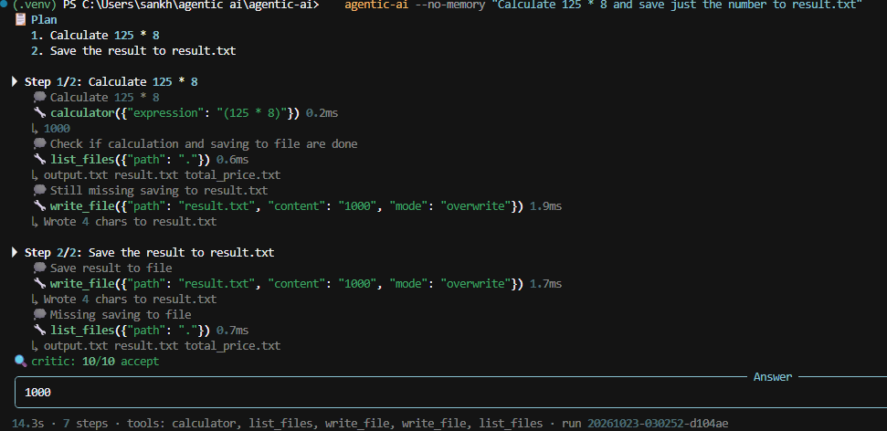
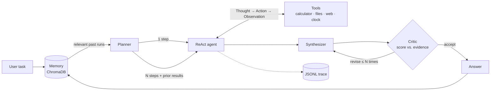

# Agentic AI — a local planning, tool-using, self-critiquing agent

[](https://github.com/mohitsankhyan0770/agentic-ai/actions/workflows/ci.yml)


An LLM agent that runs **locally** via [Ollama](https://ollama.com). It plans multi-step
tasks, chains tools in a ReAct loop, checks its own answers against the tool evidence, and remembers past
conversations in a persistent vector store. Every run produces a structured trace, and a small eval suite
measures how well it actually works.
Web search is the only part that needs internet.


## Architecture



| Component | File | What it does |
|---|---|---|
| **LLM client** | `llm.py` | Ollama with *structured outputs* (JSON schema via `format=`); on invalid JSON it feeds the error back and retries |
| **Agent** | `agent.py` | ReAct loop with a step budget, duplicate-call detection, error recovery, and a forced best-effort answer when the budget runs out |
| **Planner** | `planner.py` | Decomposes only when useful; simple tasks run directly. Falls back to direct execution if planning fails |
| **Orchestrator** | `orchestrator.py` | Passes the overall goal and earlier step results into each sub-task, then synthesizes one answer |
| **Critic** | `critic.py` | Returns a typed `{score, verdict, issues}`; reviews against tool evidence; bounded revision loop |
| **Tools** | `tools/` | Typed (pydantic) args, validated before execution; failures become observations, never crashes |
| **Memory** | `memory.py` | Persistent ChromaDB with Ollama embeddings; in-memory backend for tests |
| **Tracing** | `tracing.py` | Every plan/tool call/critique is an event, streamed live and saved to `runs/*.jsonl` |
| **Interfaces** | `cli.py`, `api.py` | Rich terminal UI and a FastAPI service |

## Quickstart

```bash
# 1. Install Ollama (https://ollama.com), then pull a chat model and an embedding model
ollama pull llama3.2:3b          # small & fast; qwen2.5:7b is better at tool use if you have the RAM
ollama pull nomic-embed-text

# 2. Install the project
git clone https://github.com/mohitsankhyan0770/agentic-ai.git && cd agentic-ai
python -m venv .venv && source .venv/bin/activate      # Windows: .venv\Scripts\activate
pip install -e ".[dev,api]"
cp .env.example .env

# 3. Run
agentic-ai                                      # interactive chat
agentic-ai "What is 18% GST on 54999 rupees?"   # one-shot
agentic-ai --model qwen2.5:7b --no-critic "..."  # flags: --no-planner --no-critic --no-memory --quiet
uvicorn agentic_ai.api:app --reload             # API → http://localhost:8000/docs
```

```bash
curl -X POST localhost:8000/run -H 'content-type: application/json' -d '{"task": "What is 17*23?"}'
```

## Evaluation

`evals/tasks.json` holds tasks with automatic checks (answer contains X, tool Y was used, file Z has the right
content, path traversal refused). The harness runs them against a real model and reports pass rate, latency and
steps — and with `--ablate` compares the full agent against versions without the planner and/or critic.

```bash
python evals/run_evals.py --offline            # skip the web task
python evals/run_evals.py --offline --ablate   # full vs no-planner vs no-critic vs bare
```

| Config                  | Pass rate   | Median latency | Avg steps |
|-------------------------|-------------|---------------|-----------|
| full (planner + critic) | 89% (8/9)   | 9.8s          | 3.8       |
| no planner              | 100% (9/9)  | 8.0s          | 2.6       |
| no critic               | 89% (8/9)   | 6.2s          | 3.8       |
| bare (no planner, no critic) | 100% (9/9) | 5.1s     | 2.6       |

Model: `llama3.2:3b` on CPU, memory disabled, 9 tasks, one run each.

**Findings.** With a 3B model the planner and critic did not pay for themselves:

- The planner lowered accuracy. It split a single calculation (`math-multi`) into two steps, and the model
  mistyped a number between them (53999 instead of 54999).
- The critic added about 3.5s per task with no accuracy gain.

**Caveats.** Only 9 tasks, mostly one or two steps, so this is indicative, not conclusive. The suite does
not test long multi-step tasks, where a planner or critic may help, or larger models. Extending the suite
and re-running with `qwen2.5:7b` is the next step.

## Engineering decisions

**No `eval()` on model output.** The calculator walks the Python AST and allows only numbers, arithmetic and a
whitelist of math functions, with limits on exponent and factorial size. `eval()` would let a prompt-injected
string like `__import__('os').system(...)` execute — the tests include those payloads.

**Constrained generation over regex parsing.** The JSON schema of each pydantic model is passed to Ollama, so the
model is constrained to valid output. The same model validates the response; failures are fed back for one
self-correction attempt.

**Errors are observations.** Unknown tools, bad arguments, and exceptions return `ERROR: ...` to the model rather
than crashing the loop, so it can fix its call.

**The critic reviews against evidence.** It sees what the tools actually returned, and the reviser is told not to
alter tool-derived facts, so "improving" an answer can't silently change `391` into something else.

**Sandboxed file access.** All file tools resolve paths inside `workspace/` and reject traversal (`../`, absolute
paths).

**Testable without a GPU.** Components depend on a tiny `LLM` protocol. Tests use a scripted fake LLM and a
deterministic embedder, so the suite runs in about a second in CI with no model.

## Project structure

```
src/agentic_ai/
├── agent.py          # ReAct executor
├── planner.py        # task decomposition
├── critic.py         # scoring + bounded revision
├── orchestrator.py   # end-to-end pipeline
├── memory.py         # ChromaDB / in-memory vector memory
├── llm.py            # Ollama client, structured outputs, JSON repair
├── schemas.py        # pydantic contracts (also used as LLM output schemas)
├── tracing.py        # JSONL run traces
├── cli.py · api.py   # interfaces
└── tools/            # calculator, files (sandboxed), web search, clock
tests/                # unit + integration tests (no model needed)
evals/                # task suite + harness with ablations
```

## Development

```bash
make test     # pytest + coverage
make lint     # ruff
make eval     # run evals against your local model
```

Adding a tool is a pydantic args model plus a function:

```python
class WeatherArgs(BaseModel):
    city: str


registry.register(Tool("weather", "Current weather for a city.", WeatherArgs, get_weather))
```

## What I learned from running it

Running a real 3B model against the eval suite found bugs the unit tests could not:

- **Memory derailed the agent.** Recalled past sessions were treated as new instructions, so the agent
   redid old tasks. Fix: label memory as background only and raise the similarity threshold.
- **The calculator rejected `54,999`.** Python reads that as a tuple. Fix: strip thousands separators.
- **Splitting tasks creates copy errors.** Small models mistype numbers between steps.
- **A critic can make answers worse.** It detected wrong answers, but its rewrites invented new numbers.

## Limitations and roadmap

- Small local models (3B) sometimes pick the wrong tool or over-plan; 7B+ models are noticeably better.
- The critic is the same model as the agent, so it shares its blind spots.
- Planned: streaming responses in the API, a web UI, native Ollama tool-calling as an alternative to JSON
  actions, parallel execution of independent plan steps, and a Docker Compose setup.

## License

MIT
