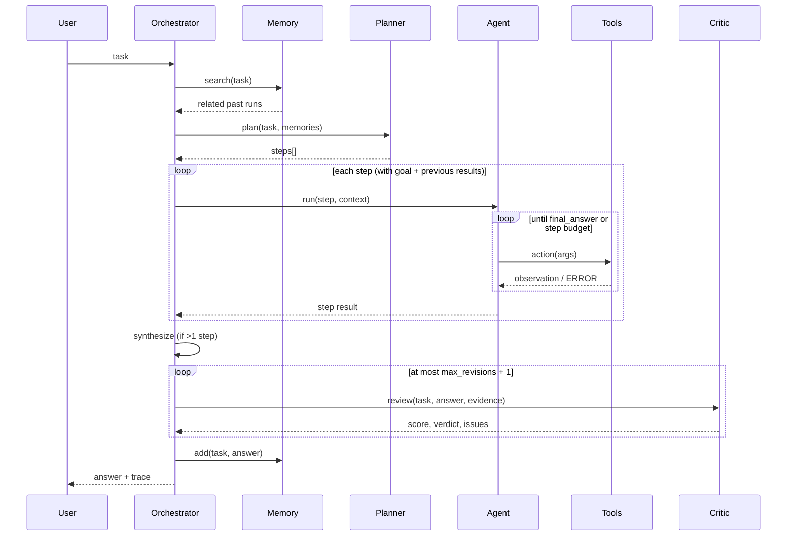

# Request lifecycle

## Failure handling

| Failure | Behaviour |
|---|---|
| Model returns invalid JSON | Error fed back; retried up to `json_retries` times, then `LLMError` |
| Unknown tool / bad args | `ERROR:` observation listing valid options; agent can retry |
| Tool raises | Exception captured as an observation |
| Same call repeated | Agent is told to use the earlier observation |
| Step budget exhausted | One forced "best answer from what you have" call, marked `success=False` |
| Planner fails | Task runs directly as a single step |
| Critic fails | Answer accepted as-is (noted in trace) |
| Memory fails | Run continues without memory (noted in trace) |
| Ollama unreachable | Clear message with the `ollama pull` command |
